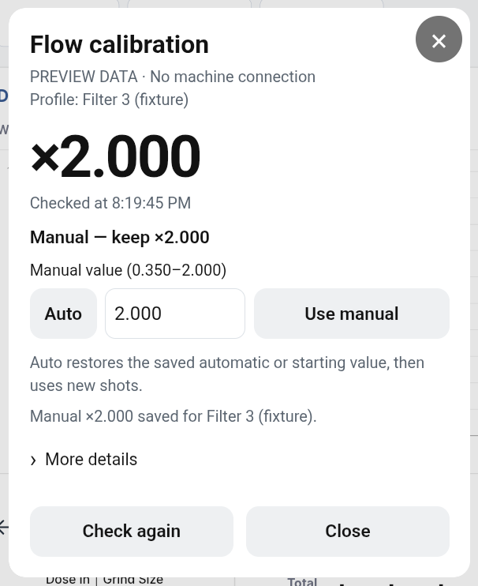

# Auto Flow Calibration UI — 2.0.3

The Brew multiplier and Manual/Auto controls belong to the **original `auto-flow-cal.reaplugin`**. The temporary `-updater` identity is retired as a product and has been removed from p85pro after the original-ID build was verified ready. The operator-approved install retained actual **0.835** calibration, checked the real read-only UI routes and left the old original state untouched. Version 2 consolidates the tested 0.4.0 behavior; it does not introduce a different estimator.

## Screenshots

These saved **M50Mini previews** show the layout and wording carried into 2.0.0. **Values are simulated**, not p85pro calibration readings or evidence of real manual writes. The preview labels are deliberately left visible.

### Automatic mode and the Brew multiplier

### Manual mode — light and dark

<table>
  <tr><th>Light</th><th>Dark</th></tr>
  <tr>
    <td></td>
    <td></td>
  </tr>
</table>

Captured during the 2026-11-26 fixture validation. Overlay screenshots are cropped to the panel; the automatic view retains the dashboard to show the Brew entry point.

## Display and controls

- Brew shows the last-read machine value, for example **×0.835**, or **M×0.835** in Manual. An unavailable value is `Cal —`, never a fitted estimate masquerading as the actual setting.
- Tap it to open the responsive light/dark overlay. Settings → Extensions also has an Open action. The overlay refreshes with identity/calibration/identity reads; opening, refreshing and reading status never apply calibration or enable anything.
- The main copy explains the current mode and next action. Optional More details exposes the estimate, support, warnings and support code without presenting internal identifiers as the main explanation.
- Use manual accepts 0.350–2.000 at three-decimal resolution. **Auto** starts from the value the machine shows at that moment, sends no calibration command and recalls nothing, then uses only subsequent usable shots. Selecting Auto while already in Automatic is allowed when the controls are otherwise safe, so the start value can be rebased deliberately.
- The Manual field offers the saved Manual value even while Automatic runs at a different live value; typing does not save it, and selecting Auto never overwrites it.
- Controls require master enable, an exact serial pin, a ready controller, fresh identity/context, between-shot state and successful persistence. Stale drafts or ambiguous requests require Check again; no silent retry.

The HTTP endpoints are `status`, `skin`, `ui`, `view`, `mode` and `recover`. The `changed` WebSocket invalidates only the skin. The original manifest declares these endpoints and `emit`/`events.machine`; endpoint declarations are not optional under Decaid's routing rules. Read-only endpoints reject mutation attempts. Explicit POST `mode` changes a selection (Automatic rebases only that profile's starting value to the live reading and sends nothing); POST `recover` adopts a reviewed current value in the profile's own mode without sending it to the machine.

## Automatic, and the remembered Manual value

**Automatic starts from the value your machine shows now.** Tapping Auto reads the pinned machine again, makes that live multiplier the profile's Automatic starting point and sends **no** calibration command. An older Automatic value, the machine baseline and a saved Manual value are not used. When the card shows **×1.000** and Automatic, a remembered Manual **2.000** is still offered in the Manual field and the helper text says it is kept; **Use manual** then applies it through the usual guarded path. The same start works while the profile is already Automatic, and only shots stored after that start can teach Automatic again.

A saved Manual value is remembered per profile title, separately from the active mode, across reads, restarts and profile switches. Returning to a profile still recalls its last effective Automatic value or its active Manual choice; the remembered Manual value of an Automatic profile is not used for that recall.

## Reviewing a paused change in 2.0.2 (unchanged)

**Check again** reviews the current workflow, target, state and saved request while calibration is paused. It never clears the pause or resends a calibration command by itself. The profile shown follows Decaid's current workflow, even while paused.

If the supported pinned machine is idle and the profile matches the paused request, a recovery panel appears. It shows the profile's mode, the multiplier that was requested and the value the machine reports now; those two values may differ. There is no free-form target field — recovery can only accept the freshly read value. After independently checking that the previous operation has finished, tick the confirmation and tap the button, which names both the value and the mode it keeps:

- **Keep ×1.000 in Automatic** — an Auto profile stays Auto. ×1.000 becomes that profile's new starting point and the expected machine value. No calibration command is sent, the old requested value is not recalled, and the earlier attempt is not marked verified. Only a genuinely new shot can teach Auto again; a pre-recovery shot delivered late is ignored, including when no earlier history exists.
- **Keep ×1.000 in Manual** — a Manual profile stays Manual. Its saved manual value becomes ×1.000 and its automatic record is retained for a later explicit Auto. The remembered Manual value follows that accepted value; an Automatic reload leaves it unchanged.

The change is recorded as an operator-authorized reload with the prior request and the replaced profile record for audit. Other profiles (for example D-Flow in Manual ×1.000), baselines and histories are preserved; the ledger is not reset. Changing profile, connection, value, mode, state, the paused request or context invalidates the review, and a value that later returns to the reviewed number does not restore the earlier confirmation — tap **Check again** to review the current state again. A failed response is not automatically retried. **More details → Verification checks** shows the checks that failed when available. Old 2.0.0 intents can be reviewed even without those newer diagnostics.

The operator confirmation is supervised policy, not proof that the host queue is empty: clearing the paused record cannot cancel a command already sent. If you cannot establish that the previous operation finished, leave the plugin disabled. The historical previews above do not show this panel. [Full recovery procedure and limitations](RELEASE-2.0.2.md).

## Profile matching

Manual choices are keyed by the exact profile title per DE1. Same-named profiles share one; rename requires a new choice. Recipe/dose/grind edits cannot silently turn a saved Manual choice back into Auto. Automatic learned values remain keyed to canonical title/version/steps.

Name matching is operator-accepted for this version. [Issue #1](https://github.com/tadelv/decaid-de1-autocal-plugin/issues/1) tracks matching to Decaid's content-hash/record/lineage model; this build does not claim that is solved.

## Persistence and safety

No old-settings migration is provided, at the sole operator's request. The original namespace uses a fresh **`calibration-v2`** key; the 1.x `state` entry is not read or overwritten. Temporary updater data is not automatically imported. Its backups must be retained during retirement. Fresh arming adopts the live multiplier without a calibration command and fences old history.

Writes wait for matching host `storageWrite` acknowledgements, save intent before dispatch and require exact read-back. Ambiguous dispatch, read-back or final persistence holds operation. Startup never blindly resends unresolved intent. External edits cannot be silently overwritten by a saved manual choice.

**Queued-write protection remains best-effort.** The plugin's GET checks and host command execution are not atomic. Do not start a shot, edit calibration, switch machines or change profiles while an update is pending. Disable prevents new dispatch, not cancellation of a command already submitted, and does not restore calibration.

## Validation and accepted limitation

The temporary 0.4.0 implementation passed controller/browser regressions and native M50Mini fixture interaction in light/dark, including keyboard entry and Manual/Auto transitions. Values on that preview were simulated; its 2.000 was not a real-machine manual command. The operator accepted the copy and v1 overlay behavior. The preview remains operator-owned and is not removed as part of the p85pro replacement.

**Accepted keyboard issue:** closing Android's keyboard can leave the overlay too small until it is scrolled. The operator accepted scrolling as a workaround for the first version; this task does not claim a resize fix.

Current regression tests exercise the compiled original-ID bundle, parser contract, escaped/untrusted text, framing-origin extraction, failed reads, stale context, explicit Manual/Auto requests, polling cleanup, decimal validation, duplicate prevention and storage failures. With `STREAMLINE_SOURCE` supplied, the actual Streamline parser is also tested; CI explicitly skips that optional case without the checkout.

**2.0.3 Automatic-start behavior is validated by automated tests only.** The compiled bundle and the generated page client are exercised together with a simulated DOM, transport and storage: Automatic from the live value with zero calibration commands despite an older Automatic value, baseline and remembered Manual value; the remembered Manual staying visible and reapplied; unsaved form text ignored; restart and profile recall; a delayed pre-start shot rejected while a new shot still learns; and a lost storage acknowledgement reporting no success. **2.0.2 recovery** keeps its own coverage (mode preservation, zero commands, delayed-shot rejection). No tablet, phone, emulator, DE1, scale, Bluetooth, firmware or native-storage check was performed for either change, and no hardware result is claimed. [2.0.3 release notes](RELEASE-2.0.3.md) · [2.0.2 release notes](RELEASE-2.0.2.md).

The operator accepted the p85pro UI, reported a successful normal shot and approved release on 2026-11-27. Read-only inspection verified Auto processing and a correct no-change result inside the deadband. Real manual hardware writes and real-device Manual/profile-switch/restart behavior have not been independently confirmed; regression/fixture coverage does not establish those hardware results. The [release notes](RELEASE-2.0.0.md) record the test scope and known limits.

## Historical trial evidence

[Trial results](trial-results.md) retain the original 0.2.0/0.4.0 activation and three-shot evidence. Ignored local artifacts preserve exact raw ledgers, settings, metadata and known submitted source. Those old observations are not a claim that settings were migrated into 2.0.0.
