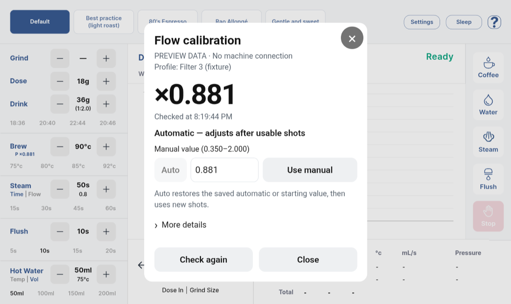
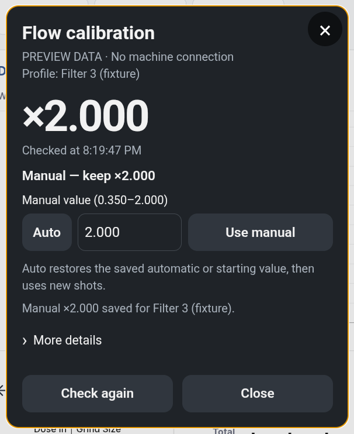

# Auto Flow Calibration UI — 2.0.0

The Brew multiplier and Manual/Auto controls now belong to the **original `auto-flow-cal.reaplugin`**. The temporary `-updater` identity is retired as a product and has been removed from p85pro after the original-ID build was verified ready. The operator-approved install retained actual **0.835** calibration, checked the real read-only UI routes and left the old original state untouched. Version 2 consolidates the tested 0.4.0 behavior; it does not introduce a different estimator.

## Screenshots

These saved **M50Mini previews** show the layout and wording carried into 2.0.0. **Values are simulated**, not p85pro calibration readings or evidence of real manual writes. The preview labels are deliberately left visible.

### Automatic mode and the Brew multiplier

### Manual mode — light and dark

<table>
  <tr><th>Light</th><th>Dark</th></tr>
  <tr>
    <td></td>
    <td></td>
  </tr>
</table>

Captured during the 2026-11-26 fixture validation. Overlay screenshots are cropped to the panel; the automatic view retains the dashboard to show the Brew entry point.

## Display and controls

- Brew shows the last-read machine value, for example **×0.835**, or **M×0.835** in Manual. An unavailable value is `Cal —`, never a fitted estimate masquerading as the actual setting.
- Tap it to open the responsive light/dark overlay. Settings → Extensions also has an Open action. The overlay refreshes with identity/calibration/identity reads; opening, refreshing and reading status never apply calibration or enable anything.
- The main copy explains the current mode and next action. Optional More details exposes the estimate, support, warnings and support code without presenting internal identifiers as the main explanation.
- Use manual accepts 0.350–2.000 at three-decimal resolution. Auto restores the current recipe's verified automatic value or starting baseline, then uses only subsequent usable shots.
- Controls require master enable, an exact serial pin, a ready controller, fresh identity/context, between-shot state and successful persistence. Stale drafts or ambiguous requests require Check again; no silent retry.

The HTTP endpoints are `status`, `skin`, `ui`, `view` and `mode`. The `changed` WebSocket invalidates only the skin. The original manifest declares these endpoints and `emit`/`events.machine`; endpoint declarations are not optional under Decaid's routing rules. Read-only endpoints reject mutation attempts; only explicit POST `mode` changes a selection.

## Profile matching

Manual choices are keyed by the exact profile title per DE1. Same-named profiles share one; rename requires a new choice. Recipe/dose/grind edits cannot silently turn a saved Manual choice back into Auto. Automatic learned values remain keyed to canonical title/version/steps.

Name matching is operator-accepted for this version. [Issue #1](https://github.com/tadelv/decaid-de1-autocal-plugin/issues/1) tracks matching to Decaid's content-hash/record/lineage model; this build does not claim that is solved.

## Persistence and safety

No old-settings migration is provided, at the sole operator's request. The original namespace uses a fresh **`calibration-v2`** key; the 1.x `state` entry is not read or overwritten. Temporary updater data is not automatically imported. Its backups must be retained during retirement. Fresh arming adopts the live multiplier without a calibration command and fences old history.

Writes wait for matching host `storageWrite` acknowledgements, save intent before dispatch and require exact read-back. Ambiguous dispatch, read-back or final persistence holds operation. Startup never blindly resends unresolved intent. External edits cannot be silently overwritten by a saved manual choice.

**Queued-write protection remains best-effort.** The plugin's GET checks and host command execution are not atomic. Do not start a shot, edit calibration, switch machines or change profiles while an update is pending. Disable prevents new dispatch, not cancellation of a command already submitted, and does not restore calibration.

## Validation and accepted limitation

The temporary 0.4.0 implementation passed controller/browser regressions and native M50Mini fixture interaction in light/dark, including keyboard entry and Manual/Auto transitions. Values on that preview were simulated; its 2.000 was not a real-machine manual command. The operator accepted the copy and v1 overlay behavior. The preview remains operator-owned and is not removed as part of the p85pro replacement.

**Accepted keyboard issue:** closing Android's keyboard can leave the overlay too small until it is scrolled. The operator accepted scrolling as a workaround for the first version; this task does not claim a resize fix.

Current regression tests exercise the compiled original-ID bundle, parser contract, escaped/untrusted text, framing-origin extraction, failed reads, stale context, explicit Manual/Auto requests, polling cleanup, decimal validation, duplicate prevention and storage failures. With `STREAMLINE_SOURCE` supplied, the actual Streamline parser is also tested; CI explicitly skips that optional case without the checkout.

Real manual hardware writes and real-device Manual/profile-switch/restart behavior remain pending operator testing. The [release checklist](RELEASE-2.0.0.md) records that gate. Publication remains separate from deployment and needs explicit approval.

## Historical trial evidence

[Trial results](trial-results.md) retain the original 0.2.0/0.4.0 activation and three-shot evidence. Ignored local artifacts preserve exact raw ledgers, settings, metadata and known submitted source. Those old observations are not a claim that settings were migrated into 2.0.0.
